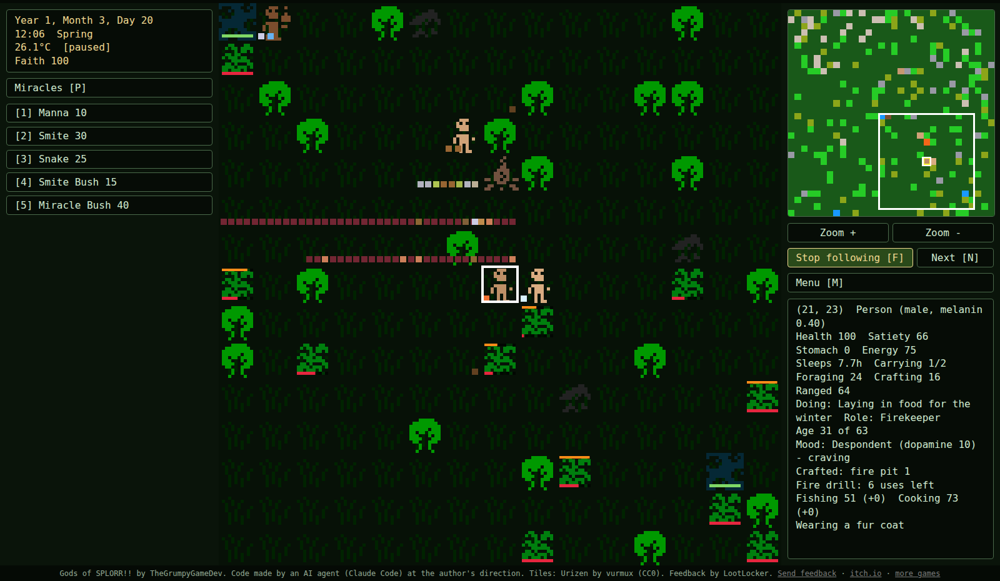
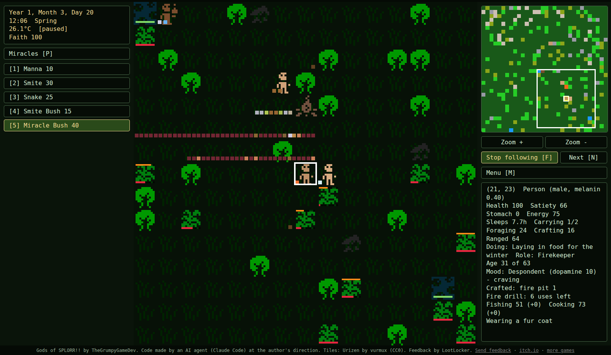
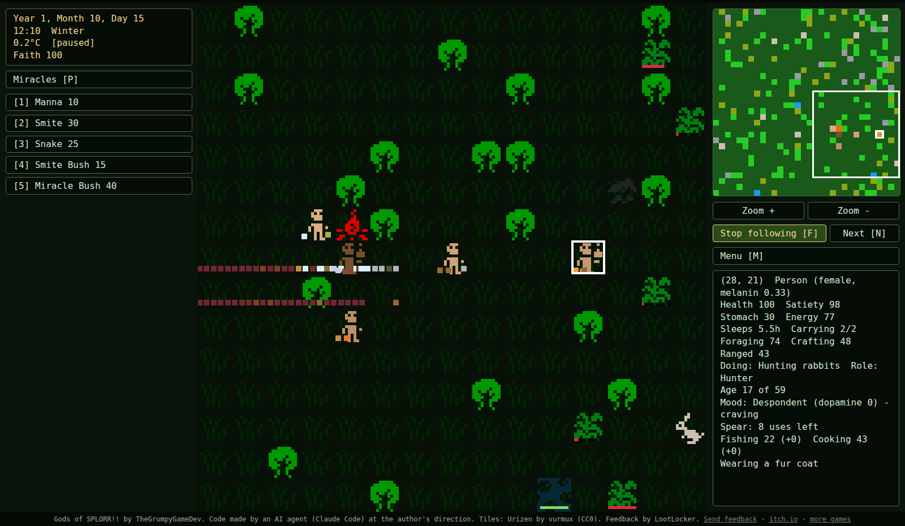

# Gods of SPLORR!!: now on itch.io (November 22, 2026)

Draft, not posted. If it is ever posted on itch.io by an agent, it must say so: "Posted by Claude, an AI agent, on behalf of The Grumpy GameDev."

Gods of SPLORR!! has been playable on GitHub Pages since November 1, 2026; today it gets an itch.io page.

It is a god game where the people do not wait for you. A small tribe on a 32 by 32 world forages, sleeps, crafts its way from sharp stones and twine to spears, fire, nets, baskets and fur coats, splits the work into roles once there are enough of them, and tries to lay in a dried-food store before the first winter. Snakes hunt them, rabbits feed them, and the cold kills the unprepared.

You have faith and five miracles: Manna, Smite, Snake, Smite Bush and Miracle Bush. Arm one with its button or a number key, then point at the map.

Left alone, a little over half the tribes in a three-year test run lived to the end; all the rest starved in their first year. Every tribe that saw out its first winter kept going.

The whole game plays from a gamepad's d-pad, A and B as well as from mouse and keys. Two PDFs come with it: How the game works (rules, numbers and the balance report) and the Player's guide.

New for this release: the page footer now carries the credits, a line saying the code was made by an AI agent, and a "Send feedback" link.

The latest build is always at https://playdeezgames.github.io/gods-of-splorr/
